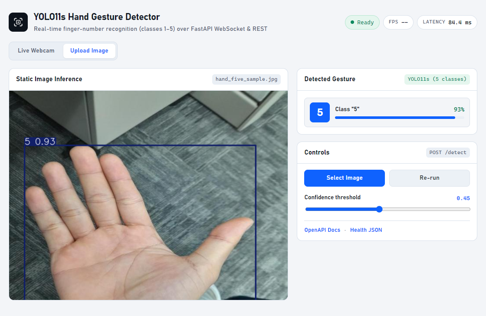
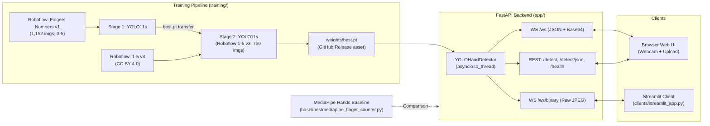
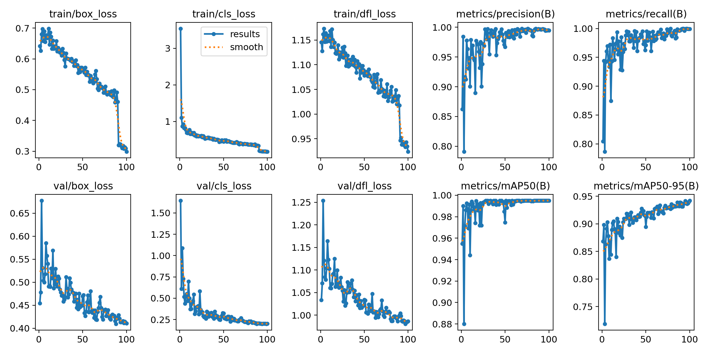
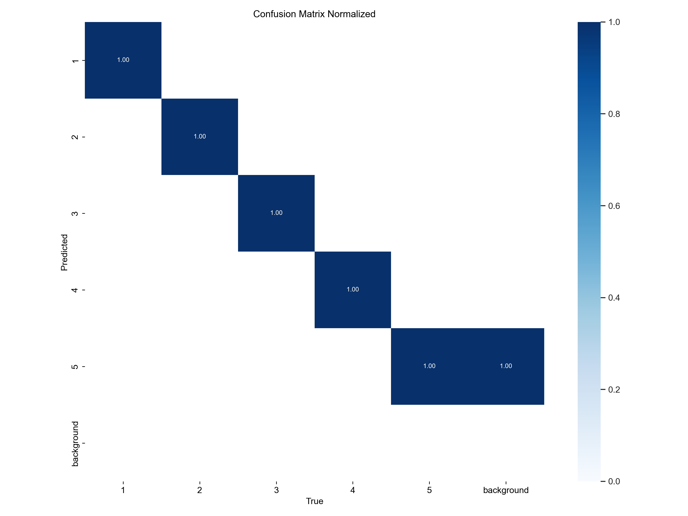
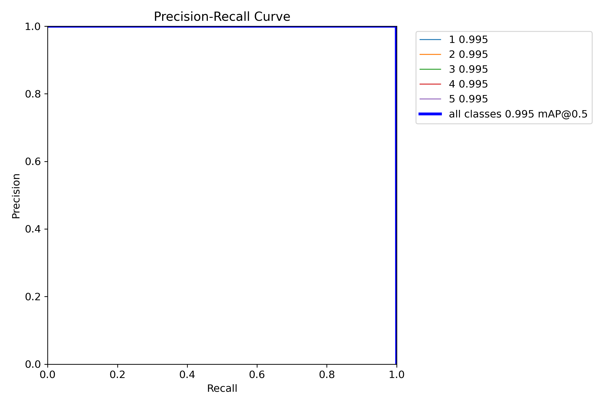

# Real-Time YOLO11s Hand Gesture Detection App

[](https://www.python.org/)
[](https://fastapi.tiangolo.com/)
[](https://docs.ultralytics.com/)
[](LICENSE)

An end-to-end computer vision project that takes a **two-stage transfer-learned YOLO11s** hand finger-number detector (classes **`1`–`5`**) from training notebook to real-time inference over **FastAPI REST & WebSockets**, paired with a lightweight browser UI, an optional **Streamlit** webcam client, and a **MediaPipe Hands** rule-based baseline.



---

## Highlights

- **Two-Stage Transfer Learning (`YOLO11s`)**: Pre-trained on COCO → fine-tuned on Roboflow *Fingers Numbers v1* (`0–5`) → transfer-learned onto Roboflow *1-5 v3* (`1–5`), reaching **0.995 mAP@50** and **0.941 mAP@50–95** on validation at ~7.6 ms/frame (RTX 2060).
- **Single Unified FastAPI Backend**:
  - `POST /detect` (annotated PNG) & `POST /detect/json` (structured bounding boxes, labels, confidence, latency)
  - `WS /ws` (base64 JSON streaming for browser clients)
  - `WS /ws/binary` (raw JPEG binary streaming for Python / Streamlit clients)
  - Non-blocking inference via `asyncio.to_thread`, payload validation, and `GET /health` readiness endpoint.
- **Zero-Build Web UI (`app/static/`)**: Live webcam streaming with configurable resolution, JPEG quality, confidence threshold, and FPS cap — plus a static **Upload Image** mode for testing without a camera.
- **Optional Clients & Engineering Baseline**:
  - `clients/streamlit_app.py`: alternative real-time Streamlit client over `/ws/binary`.
  - `baselines/mediapipe_finger_counter.py`: zero-training MediaPipe Hands landmark baseline (1–2 hands, handedness-aware thumb detection) for comparing classical/landmark heuristics vs. fine-tuned deep learning.

---

## Architecture



---

## Repository Structure

```text
realtime-yolo-hand-detection-app/
├── app/
│   ├── config.py                     # Environment-based runtime settings
│   ├── detector.py                   # YOLO11s wrapper + safe image decode/encode helpers
│   ├── main.py                       # FastAPI app (REST + WebSocket + lifespan)
│   └── static/                       # Pure HTML/CSS/JS frontend & favicons
├── clients/
│   └── streamlit_app.py              # Optional Streamlit client connected to /ws/binary
├── baselines/
│   └── mediapipe_finger_counter.py   # Rule-based MediaPipe Hands baseline (1-2 hands)
├── training/
│   └── train_yolo11_fingers.ipynb    # Clean two-stage transfer learning notebook
├── scripts/
│   └── download_weights.py           # Downloads weights/best.pt from GitHub Releases
├── tests/
│   ├── test_api.py                   # Weight-free mock API/WS tests + optional real_model test
│   └── test_baseline.py              # Unit tests for MediaPipe finger counting logic
├── docs/assets/                      # Training curves, confusion matrix, UI preview
├── weights/.gitkeep                  # Local target directory for best.pt (gitignored)
├── .env.example
├── requirements.txt                  # Core serving dependencies
└── requirements-extras.txt           # Optional Streamlit, MediaPipe, Roboflow, pytest
```

---

## Model Training & Evaluation

The deployed model (`best.pt`, ~18.7 MB) is a `YOLO11s` detector trained in two stages (100 epochs each, `imgsz=640`, `batch=16`, NVIDIA RTX 2060):

| Stage | Dataset (Roboflow, CC BY 4.0) | Split | Images | Precision | Recall | mAP@50 | mAP@50–95 | Inference Speed |
| :--- | :--- | :--- | :---: | :---: | :---: | :---: | :---: | :---: |
| **Stage 1** | `wyde/fingers-numbers-mobih` v1 (`0–5`) | Val | 185 | 0.999 | 1.000 | 0.995 | 0.944 | 7.7 ms/img |
| **Stage 1** | `wyde/fingers-numbers-mobih` v1 (`0–5`) | Test | 128 | 0.995 | 1.000 | 0.995 | 0.949 | 8.4 ms/img |
| **Stage 2 (Deployed)** | `wyde/1-5-y1dwp-muxo0` v3 (`1–5`) | Val | 173 | **0.995** | **0.999** | **0.995** | **0.941** | **7.6 ms/img** |
| **Stage 2 (Deployed)** | `wyde/1-5-y1dwp-muxo0` v3 (`1–5`) | Test | 53 | 0.991 | 1.000 | 0.995 | 0.905 | 9.4 ms/img |

**Stage 2 Per-Class Validation `mAP@50–95` (all 5 classes represented):**
- Class `1` (26 instances): **0.878**
- Class `2` (60 instances): **0.904**
- Class `3` (27 instances): **0.968**
- Class `4` (28 instances): **0.967**
- Class `5` (32 instances): **0.990**

> **Dataset split note:** In the upstream Roboflow `1-5` v3 test split (53 images), only classes `1`, `2`, and `5` are present; the validation split (173 images) covers all 5 classes evenly and is therefore the primary per-class benchmark.

### Training Curves & Confusion Matrix (Stage 2)



| Normalized Confusion Matrix | Precision–Recall Curve |
| :---: | :---: |
|  |  |

---

## Baseline Comparison: MediaPipe Landmarks vs. YOLO11s

| Aspect | MediaPipe Hands Baseline (`baselines/`) | Fine-Tuned YOLO11s (`app/`) |
| :--- | :--- | :--- |
| **Paradigm** | Pretrained 21-point hand skeleton + geometric rules | End-to-end object detection + gesture classification |
| **Training Data Required** | Zero (works out of the box) | Custom labeled dataset (two-stage transfer learning) |
| **Supported Output** | Total finger count `0–10` (1 or 2 hands) | Per-hand bounding box + class `1–5` + confidence |
| **Strengths** | Very fast on CPU, no domain training needed | Robust to hand rotation/angle once trained, extensible to arbitrary gestures |
| **Limitations** | Sensitive to hand orientation, partial occlusion, thumb geometry heuristics | Needs retraining/fine-tuning for unseen gestures or lighting shifts |

---

## Quick Start

### 1. Clone and install dependencies

Python **3.10–3.12** is recommended (MediaPipe in `requirements-extras.txt` requires Python ≤ 3.12).

```bash
git clone https://github.com/wyde1/realtime-yolo-hand-detection-app.git
cd realtime-yolo-hand-detection-app

python -m venv .venv
# Linux / macOS:
source .venv/bin/activate
# Windows PowerShell:
# .venv\Scripts\Activate.ps1

pip install -r requirements.txt
```

*(Optional)* Install extras for the Streamlit client, MediaPipe baseline, training notebook, and pytest:

```bash
pip install -r requirements-extras.txt
```

### 2. Download the trained weights (`best.pt`)

Model checkpoints (`*.pt`) are excluded from Git history and distributed via GitHub Releases:

```bash
python scripts/download_weights.py
```

If the release is not yet published or you trained your own checkpoint, copy `best.pt` manually to `weights/best.pt` (or set `MODEL_PATH=/path/to/best.pt`).

### 3. Start the FastAPI server & Web UI

```bash
uvicorn app.main:app --host 0.0.0.0 --port 8000
```

Open [http://127.0.0.1:8000](http://127.0.0.1:8000) in your browser:
- Use **Live Webcam** to stream frames over `WS /ws` with adjustable confidence, JPEG quality, resolution, and FPS cap.
- Use **Upload Image** to test static images via `POST /detect` and `POST /detect/json`.
- Explore interactive Swagger docs at [http://127.0.0.1:8000/docs](http://127.0.0.1:8000/docs).

### 4. Optional: Run the Streamlit client or MediaPipe baseline

With the FastAPI server running on port `8000`:

```bash
streamlit run clients/streamlit_app.py
```

Run the standalone MediaPipe rule-based baseline (1 or 2 hands):

```bash
python baselines/mediapipe_finger_counter.py --max-hands 2
```

---

## API Reference

| Method & Path | Description |
| :--- | :--- |
| `GET /` | Serves the browser Web UI (`app/static/index.html`) |
| `GET /health` | Server & model readiness JSON (`status`, `model_loaded`, `classes`, `default_conf`) |
| `POST /detect?conf=0.45` | Multipart image upload → returns annotated `image/png` (`X-Detections-Count`, `X-Inference-Ms` headers) |
| `POST /detect/json?conf=0.45` | Multipart image upload → returns JSON `{detections, count, inference_ms, image_size}` |
| `WS /ws` | Real-time base64 JSON stream (`{"image": "data:image/jpeg;base64,...", "conf": 0.45, "quality": 75}`) |
| `WS /ws/binary?conf=0.45` | Real-time raw JPEG/PNG binary stream → returns annotated JPEG bytes |

Example `curl` calls:

```bash
# Check server and loaded classes
curl http://127.0.0.1:8000/health

# Get structured JSON detections
curl -X POST "http://127.0.0.1:8000/detect/json?conf=0.45" \
  -F "file=@hand_sample.jpg"

# Save annotated PNG image
curl -X POST "http://127.0.0.1:8000/detect?conf=0.45" \
  -F "file=@hand_sample.jpg" \
  --output annotated.png
```

---

## Reproducing Training

1. Copy `.env.example` to `.env` and set `ROBOFLOW_API_KEY`.
2. Install optional dependencies (`pip install -r requirements-extras.txt`).
3. Open and run `training/train_yolo11_fingers.ipynb`.
4. The final cell exports `runs/detect/stage2_fingers_1_5/weights/best.pt` to `weights/best.pt`.

---

## Running Tests

The default test suite uses a mock detector and passes even without `weights/best.pt`:

```bash
pytest -v -m "not real_model"
```

Run the full suite including real YOLO11s integration tests (automatically skipped if `weights/best.pt` is missing):

```bash
pytest -v
```

---

## Dataset Attribution & License

- **Stage 1 Dataset**: [Fingers Numbers v1](https://universe.roboflow.com/wyde/fingers-numbers-mobih/dataset/1) on Roboflow Universe — licensed under **CC BY 4.0**.
- **Stage 2 Dataset**: [1-5 v3](https://universe.roboflow.com/wyde/1-5-y1dwp-muxo0/dataset/3) on Roboflow Universe — licensed under **CC BY 4.0**.
- **Source Code**: Released under the [MIT License](LICENSE).
